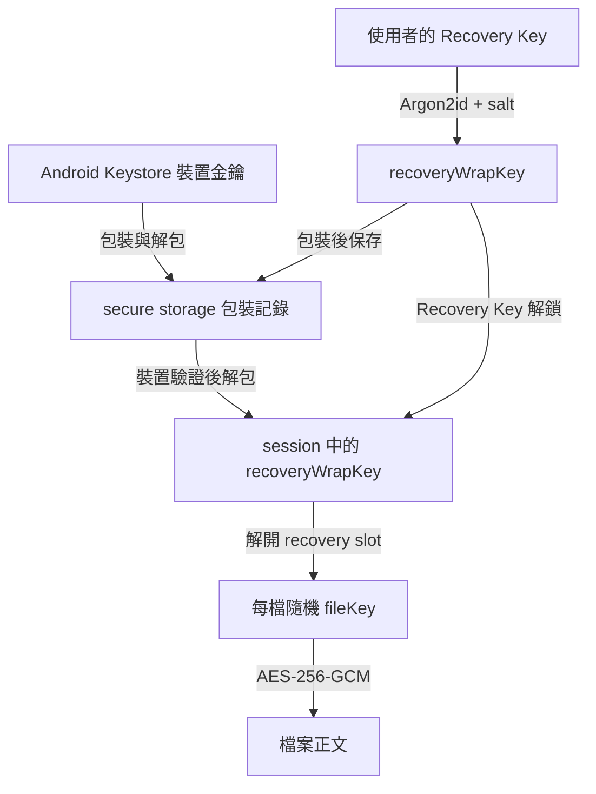

# 加密格式

本文說明 LDJ2 檔案、Recovery Key、可信裝置與索引金鑰的分工。儲存路徑與備份範圍見[本機儲存](../資料/本機儲存.md)，驗證與鎖定流程見[解鎖與會話](解鎖與會話.md)。

## 兩層金鑰架構

| 材料 | 來源與保存方式 | 用途 |
|------|------|------|
| Recovery Key | 使用者保存；不以明文寫入日記庫 | 經 Argon2id 衍生日記庫包裝金鑰 |
| `recoveryWrapKey` | 由 Recovery Key 與 KDF 參數衍生；解鎖後供 session 使用 | 解開各檔的 recovery slot、衍生索引金鑰 |
| `fileKey` | 每次加密產生的隨機 256-bit 金鑰；只以包裝後形式落地 | AES-256-GCM 加密單一檔案正文 |
| `WrappedRecoveryKeyRecord` | secure storage 內的包裝記錄；需搭配 Android Keystore 金鑰 | 讓可信裝置恢復 `recoveryWrapKey` |



可信裝置保護的是日記庫層的包裝金鑰。新檔不建立逐檔 device slot，也不把 Android Keystore slot ID 寫進 LDJ2 header。「無」解鎖模式仍使用裝置包裝，只是不要求系統驗證。

## 復原金鑰生成與輸入

新金鑰由 `Random.secure()` 取得恰好 15 bytes，將全部 120 bits 無損編碼為 24 個 Crockford Base32 字元，每四碼一組；安全亂數失敗時停止，不使用一般亂數替代。完整金鑰有 120-bit 隨機熵，公開最後四碼提示後剩餘 100-bit。一般物件 ID 使用 ULID 生成。

生成字母表為 `0123456789ABCDEFGHJKMNPQRSTVWXYZ`。輸入沿用 Crockford 慣例接受大小寫、空白與分組符號，`I`／`L` 對應 `1`，`O` 對應 `0`；其他無效或過長內容保留在欄位並阻止提交。KDF 接收包含連字號的大寫標準字串 UTF-8 bytes，不能改用去除分組的字串。

歷史固定樣本見 [`test/fixtures/security/`](../../../test/fixtures/security/)，涵蓋二次與三次迭代，預期結果不由新版即時重建。

## `recovery.json`

`vault/recovery.json` 是明文復原描述子，包含 `schema_version`、`vault_id`、`recovery_enabled`、`recovery_key_version`、`recovery_key_hint`、`created_at` 與 `kdf`。提示只保存 Recovery Key 最後 4 碼，不含完整金鑰。

目前 KDF 寫入值如下；實際解鎖採用該份 metadata 的參數，不以最新預設覆蓋：

| 參數 | 值 |
|------|------|
| `name` | `argon2id` |
| `memory` | `19456` KiB |
| `iterations` | `3` |
| `parallelism` | `1` |
| `hash_length` | `32` bytes |
| `salt` | 合法 Base64，解碼後 16～64 bytes |
| `purpose` | `recovery_wrapping` |

解析及執行 Argon2id 前均驗證參數：Memory 為 `8 × parallelism`～32,768 KiB、Iterations 1～6、Parallelism 必須為 1、Hash length 必須為 32 bytes，Salt 為 16～64 bytes。不修正非法值後重試。KDF 在背景 isolate 執行，同一 App isolate 的所有 `LocalCryptoService` 實例共用序列，同時最多一項。

復原描述子與 LDJ2 header 目前皆為第 1 版，版本由 [`DataVersions`](../../../lib/shared/data_versions.dart) 管理。`recovery_key_version` 必須至少為 1。還原時以日記庫 ID 與完整 KDF 參數比對復原金鑰世代，其中 Salt 比對解碼後的內容。

## LDJ2 檔案結構

```text
[magic "LDJ2" 4B][header length uint32 BE 4B][UTF-8 JSON header][ciphertext || GCM tag]
```

header 是可讀的明文中繼資料，正文才加密。正文與 recovery slot 都使用 AES-256-GCM、12-byte nonce 與 16-byte tag；兩者各自產生 nonce。

### Header 結構

[`EncryptedDocumentHeader`](../../../lib/infrastructure/crypto/crypto_service.dart) 寫入以下欄位：

| 欄位 | 內容 |
|------|------|
| `schema_version` | `1` |
| `file_id`、`vault_id` | 邏輯檔案與日記庫識別 |
| `content_type` | 原內容類型，例如 `text/markdown`、`application/json` |
| `created_at`、`updated_at` | 邏輯建立與更新時間 |
| `cipher` | `aes-256-gcm` |
| `nonce` | 正文 nonce，base64 |
| `key_slots` | 至少一個 recovery slot |

header 原始位元組作為正文的 AAD；修改時間或其他欄位也會使認證失敗。寫入目前使用 `jsonEncode(header.toJson())` 的 UTF-8 結果，並非通用的 JSON 鍵排序正規化規格。解密必須使用檔案原有 header bytes，不能先重新序列化。

### Recovery slot

| 欄位 | 內容 |
|------|------|
| `slot_id`、`slot_type` | 新檔皆寫 `recovery` |
| `wrap_algorithm` | `aes-256-gcm` |
| `wrapped_key` | 以 `recoveryWrapKey` 包裝的 `fileKey`，含 tag，base64 |
| `nonce` | slot 自己的 nonce，base64 |
| `kdf` | 該復原世代的 KDF 描述 |
| `platform` | 可選的保留欄位，目前 recovery slot 不依賴它 |

新檔只建立單一 recovery slot；讀取允許多個 recovery slot，但實際解密取第一個，不逐一嘗試。未知 slot type、不支援的包裝演算法或缺少 KDF 描述都會被拒絕。逐檔解密直接使用 session 的 `recoveryWrapKey`，不依 slot KDF 重新執行 Argon2id。

## 寫入與解密

[`LocalCryptoService`](../../../lib/infrastructure/crypto/crypto_service.dart) 的寫入順序：

1. 產生隨機 `fileKey`，以 `recoveryWrapKey` 包裝為 recovery slot。
2. 建立含正文 nonce 的 header，取得 UTF-8 JSON bytes。
3. 以 `fileKey` 加密正文，將完整 header bytes 作為 AAD。
4. 組合 magic、header 長度、header、密文與 tag。

解密分為三個層次：

| 層次 | 檢查與限制 |
|------|------|
| `parseFileBytes()` | 檢查 magic、長度邊界、64 KiB header 上限、JSON 及基本 header／slot 格式；不代表密文已通過認證 |
| `decryptBytes()` | 用 `recoveryWrapKey` 解第一個 recovery slot，再以原 header bytes 驗證並解密正文；失敗不回傳部分內容 |
| 各儲存入口 | 核對預期日記庫、檔案 ID、內容類型與 JSON 結構；不是所有檔案都由通用解密器完成身分核對 |

`DecryptionContext` 雖帶有 `vaultId`、`trustedDevice`、`deviceSlotId`，通用解密器不會自動將 context 的日記庫 ID 與 header 比對，也不依 trusted device 旗標改用逐檔 Keystore 解密。AAD 能證明檔頭未被竄改，不能證明「這就是呼叫端預期的檔案」；敏感續跑資料與 AI JSON 的儲存層須另做身分核對。

錯誤的 magic、長度、版本、cipher、slot、nonce、金鑰，或遭竄改的 header／密文／tag，都會在對應解析或解密階段失敗。

## 可信裝置包裝記錄

[`WrappedRecoveryKeyRecord`](../../../lib/infrastructure/security/device_key_manager.dart) 包含 `slot_id`、`nonce`、`ciphertext`、`wrapped_at`、`format_version`、`platform`。記錄存在 secure storage，真正的裝置金鑰留在 Android Keystore；任一部分遺失或失效，都不能只靠另一部分恢復包裝金鑰。

可信裝置解鎖先呼叫 `DeviceKeyManager.unwrapWithDeviceKey()`，得到 `recoveryWrapKey` 後建立 session；各 LDJ2 檔案仍走相同的 recovery slot 路徑。記錄格式驗證與異常復原見[本機儲存](../資料/本機儲存.md#遠端清理-json-與金鑰維護)。

## 搜尋索引金鑰衍生

索引沒有另外保存一把明文金鑰。[`deriveIndexDatabaseKey()`](../../../lib/infrastructure/database/index_key_derivation.dart) 使用：

```text
HKDF-SHA256(
  secret = recoveryWrapKey,
  nonce = utf8(vaultId),
  info = "quill_diary:index:v1",
  len = 32
)
```

`info` 來源為 `AppIdentifiers.indexKeyDerivationInfo`。Recovery Key 輪替改變包裝金鑰時，索引金鑰也會改變；只有切換裝置驗證方式不會改變此衍生結果。索引開啟、刪除與重建是不同操作，見[索引資料庫](../資料/索引資料庫.md)。

## Manifest 與金鑰驗證

### 本機日記庫

`VaultRepository._verifyRecoveryKey()` 優先解密 `manifest.json.enc`；manifest 存在但驗證失敗時，不退回其他樣本。

沒有 manifest 時，依序嘗試已存在的 `people.json.enc`、按路徑排序的 `entries/**/*.md.enc`，再嘗試 `entries/` 與 `assets/` 內其他加密檔。任一樣本成功即可，不能視為所有日記與附件都通過完整性檢查。若完全沒有候選樣本，這個方法直接返回，並沒有完成密碼學上的金鑰驗證。

### 完整備份 ZIP

`VaultBackupIo.verifyBackupRecoveryKey()` 先讀 recovery metadata，再取 manifest；沒有 manifest 時取封存中的第一份 `.md.enc`，交給 `verifyRecoveryKeyAgainstBackupBytes()` 驗證。這條路徑不逐一嘗試所有日記，且沒有樣本會回報 `noEncryptedSample`。

金鑰認證失敗回報 `recoveryKeyMismatch`；封存或格式錯誤另外處理。結構檢查、金鑰樣本驗證與全庫可讀性是三件事，見[備份與還原](../功能/備份與還原.md)。

## 何時會重包裝（rewrap）

`rewrap` 在目前程式裡包含兩種不同範圍，維護時須分清楚：

| 情境 | 實際變更 |
|------|------|
| 切換裝置驗證方式或同步 Keystore 策略 | 調整裝置層包裝；若只是索引後綴落後，僅同步索引值，不逐檔重加密 |
| 正常 Recovery Key 解鎖並重建裝置信任 | 日記庫內加密檔重新加密、保存裝置包裝記錄並重建索引；包裝金鑰本身不變 |
| 輪替 Recovery Key | 新 salt、新包裝金鑰；逐檔重加密後才更新 recovery metadata，另更新裝置包裝與索引 |

逐檔重加密目前會產生新的 `fileKey` 與 nonce，保留邏輯檔案 ID、內容類型及建立時間，更新 header 的更新時間；不是只修改 key slot。

新金鑰維護先檢查分身替換狀態。主檔缺失而只剩替換副本時，Recovery Key 解鎖可退為不新增裝置信任的復原 session，不自動啟用舊分身，也不執行正常整庫 rewrap。已有中斷工作的恢復則須驗證既有旗標或 pending，詳見[解鎖分流](解鎖與會話.md#recovery-key-解鎖)與[金鑰維護](../資料/本機儲存.md#遠端清理-json-與金鑰維護)。

[← 返回開發文件導覽](../README.md)
