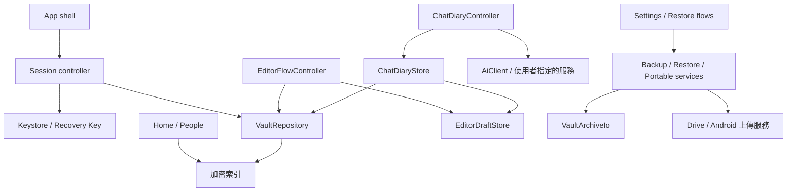

# 系統架構

Quill Diary 是以 Android 為支援平台的本機加密日記系統，包含解鎖 session、搜尋索引、人物名冊、AI 聊天與手動備份。型別與組裝點見[模組參考](模組參考.md)。

## 專案分層

| 目錄 | 責任 |
|------|------|
| `lib/app/` | App shell、路由、主題與生命週期整合 |
| `lib/presentation/` | 頁面、widget 與使用者互動 |
| `lib/application/` | controller、flow、Provider 與跨模組協調 |
| `lib/domain/` | 領域模型、值物件與純規則，不依賴 Flutter UI |
| `lib/infrastructure/` | 加密、儲存、資料庫、裝置安全與外部服務 |
| `lib/shared/` | 跨功能共用的 UI 與工具 |
| `lib/l10n/` | ARB 文案與產生的在地化程式 |

`presentation` 不決定儲存格式；`application` 協調 I/O；平台與檔案系統操作留在 `infrastructure`。

## App shell 與路由

[`main.dart`](../../../lib/main.dart) 初始化 binding 與 ProviderScope；[`app.dart`](../../../lib/app/app.dart) 建立 Router、套用語言與主題、接上 session 生命週期與導頁，並啟動 Billing。

[`router.dart`](../../../lib/app/router.dart) 使用單一 GoRouter：

| 路由 | 用途 |
|------|------|
| `/` | 首頁、日曆、標籤、人物與總覽 |
| `/editor`、`/editor/:entryId` | 新增或編輯日記；`chat` query 指定聊天的生成草稿 |
| `/chat-diary/new/:id` | 建立新聊天 |
| `/chat-diary/:id` | 接續聊天草稿 |
| `/chat-diary/entry/:entryId` | 讀取日記旁的完成聊天 |
| `/people/:id` | 人物詳情 |
| `/settings` | 設定 |
| `/settings/about`、`/settings/personalization`、`/settings/support` | 介紹、個人化與支持 |

聊天與日記 ID 在路由入口驗證；鎖定後是否可恢復路徑由 session 模組決定。

## 模組與資料流

- Session 管理解鎖、背景逾時、重新驗證與還原後接手；索引只在可用 session 下開啟。
- Editor 協調一般草稿、附件與正式儲存。Chat Diary 管理分支、隱私處理、串流及日記草稿交接。
- `VaultRepository` 管理正式日記、附件、manifest、人物與索引一致性。日記修改、聊天儲存、備份與金鑰輪替共用 vault 修改序列。
- `VaultArchiveIo` 提供完整備份、還原與可攜式 I/O；上層 capability service 負責選檔、交付與權限條件。
- Drive 使用 `appDataFolder`，只在使用者操作後備份或還原；Android 前景服務可完成已啟動的上傳。
- Billing 是 Google Play 一次性支持，不提供功能解鎖。

主要組裝點是 [`storage_providers.dart`](../../../lib/infrastructure/storage/storage_providers.dart)；AI 與聊天的組裝分別在 `application/ai/`、`application/chat_diary/`。

### 開發時追蹤的主要流程

| 流程 | 協調順序與提交邊界 |
|------|------|
| 啟動與解鎖 | App shell 接 session 狀態 → 裝置驗證或復原金鑰 → 開啟 vault 與索引 → 首頁查詢。尚未建庫另走首次啟動流程 |
| 編輯與儲存 | 頁面欄位 → `EditorFlowController` → 加密草稿與 pending 附件；正式儲存才交 `VaultRepository` 並更新索引，成功後清草稿 |
| 聊天與生成 | `ChatDiaryController` 對目前分支做隱私處理 → `AiClient` → `ChatDiaryStore` 暫存生成附件與草稿 → 確認操作有效後發布 → 編輯器正式儲存後完成聊天 |
| 完整備份 | transfer capability 檢查前置條件 → 在 vault 修改序列建立 ZIP → 檢查 ZIP → 本機／SAF／Drive 交付；ZIP 的存在不能直接代表雲端上傳成功 |
| 還原 | 預檢與備份金鑰驗證 → 換入 vault → session 收尾、清草稿與預覽 → 重建索引並刷新查詢 |

首頁讀取透過 Provider 與索引查詢，不在每次重繪時掃描日記原檔；人物分析延後到相關功能需要時才補建。狀態是否可查詢、可寫入或需要重新驗證，由 application/session 與 capability 決定，widget 不自行放寬限制。

非同步流程以操作版本阻止過期結果套回頁面；磁碟清理與提交仍須由儲存層完成。只在 UI 忽略晚到結果不足以避免孤兒檔案，取消不能略過已交接給儲存層的收尾。

## 本機資料位置

除系統暫存與安全儲存外，下列路徑相對於 `{appSupport}/quill_diary/`，由 [`VaultPathStrategy`](../../../lib/infrastructure/storage/vault_path_strategy.dart) 計算。

| 路徑 | 內容 |
|------|------|
| `vault/recovery.json` | 明文復原 metadata 與 KDF 描述 |
| `vault/manifest.json.enc` | 加密 manifest |
| `vault/people.json.enc` | 加密人物名冊 |
| `vault/entries/YYYY/MM/*.md.enc` | 正式日記 |
| `vault/entries/YYYY/MM/*.chat.json.enc` | 完成聊天，與所屬日記同目錄 |
| `vault/assets/YYYY/MM/*.<ext>.enc` | 正式附件 |
| `vault/chat_diary_drafts/<chatId>/` | 未完成聊天、原圖及 `editor/` 生成草稿 |
| `vault/chat_diary_remote_cleanup/` | 加密的 AI 遠端檔案清理紀錄 |
| `vault/tag_styles.json`、`vault/pinned_entries.json` | 明文標籤目錄／樣式與釘選 ID |
| `index/journal_index.sqlite` | 可重建的加密搜尋與人物分析索引 |
| `drafts/{draftKey}/` | 一般編輯草稿與加密 pending 附件 |
| `backups/backup_*.zip` | 本機完整備份 |
| `app_preferences.json`、`app_lock_store.json` | vault 外的個人化與解鎖偏好 |

AI 連線、API Key 與自訂提示詞放在 `quill_diary_ai` 安全儲存 namespace。草稿附件的解密預覽位於系統暫存目錄，鎖定或還原時清除。

## 資料與恢復邊界

- 正式日記是搜尋、統計及 Markdown／HTML 匯出的來源；聊天本身不加入這些查詢。
- 人物名冊是正式資料，姓名分析與搜尋索引可重建。
- 完整備份包含完成聊天，排除一般草稿、未完成聊天、遠端清理紀錄、索引與 AI 設定。詳細清單以[備份與還原](../功能/備份與還原.md)為準。
- trusted device 失效時清除本機可信存取，回到復原金鑰；索引不可讀或 schema 不相容時重建。
- 還原完成後重建 session 並刷新查詢，不能沿用與新 vault 不一致的資源。

[← 返回開發文件導覽](../README.md)
