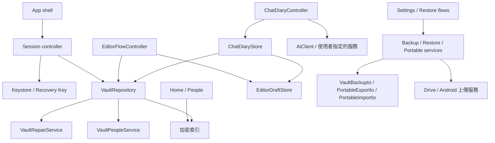

# 系統架構

Quill Diary 是以 Android 為支援平台的本機加密日記系統，包含解鎖 session、搜尋索引、人物名冊、AI 聊天與手動備份。型別與組裝點見[模組參考](模組參考.md)。

## 專案分層

| 目錄 | 責任 |
|------|------|
| `lib/app/` | App shell、GoRouter 組裝與生命週期整合 |
| `lib/presentation/` | 頁面、widget 與使用者互動 |
| `lib/application/` | controller、flow、Provider 與跨模組協調 |
| `lib/domain/` | 領域模型、值物件與純規則，不依賴 Flutter UI |
| `lib/infrastructure/` | 加密、儲存、資料庫、裝置安全與外部服務 |
| `lib/shared/` | 穩定應用識別、路由契約、跨功能 UI 與主題 |
| `lib/l10n/` | ARB 文案與產生的在地化程式 |

`presentation` 不決定儲存格式；`application` 協調 I/O、組裝 Provider 與發布狀態變更；平台與檔案系統操作留在 `infrastructure`。後者不依賴 application、畫面文案或 UI 顏色工具。domain 不依賴 Flutter。

日記摘要、草稿記錄、待存附件、標籤及偏好值屬 domain；SQL row 解析留在資料庫，畫面欄位快照與 dirty 判斷留在編輯器流程。應用識別常數不因移檔而改值。

同一份畫面狀態的 callback 與小型確認視窗隨頁面放在一起；可獨立使用的標籤選擇器、圖庫及流程才分開。分檔依責任與生命週期，不依行數。

手寫程式引用 `lib/` 內檔案一律使用 `package:quill_diary/...`；測試輔助檔之間使用相對路徑，在地化產生碼保留 Flutter 產生器的輸出。`analysis_options.yaml` 啟用 `always_use_package_imports` 與 `directives_ordering`，持續檢查引用方式與排序。

本機資料格式、索引世代及首次介紹的內容版本集中於 [`DataVersions`](../../../lib/shared/data_versions.dart)，目前皆從 `1` 開始。各欄位獨立升版，不共用一個通用版本號；非同步操作序號與遠端 API 版本由各自流程管理。App 發行版本只由 [`pubspec.yaml`](../../../pubspec.yaml) 的 `version:` 管理，Android 沿用 Flutter 建置提供的版本；日記庫 manifest 不再保存重複的 App 版本欄位。

## App shell 與路由

[`main.dart`](../../../lib/main.dart) 初始化 binding 與 ProviderScope；[`app.dart`](../../../lib/app/app.dart) 建立 Router、套用語言與主題、接上 session 生命週期與導頁，並啟動 Billing。

路徑與位置產生函式集中於 [`AppRoutes`](../../../lib/shared/navigation/app_routes.dart)，[`router.dart`](../../../lib/app/router.dart) 只組裝單一 GoRouter 與頁面：

| 路由 | 用途 |
|------|------|
| `/` | 首頁、日曆、標籤、人物與總覽 |
| `/editor`、`/editor/:entryId` | 新增或編輯日記；`chat` query 指定聊天的生成草稿 |
| `/chat-diary/new/:id` | 建立新聊天 |
| `/chat-diary/:id` | 接續聊天草稿 |
| `/chat-diary/entry/:entryId` | 讀取日記旁的完成聊天 |
| `/people/:id` | 人物詳情 |
| `/settings` | 設定 |
| `/settings/about`、`/settings/personalization`、`/settings/support` | 介紹、個人化與支持 |

聊天與日記 ID 在路由入口驗證；鎖定後是否可恢復路徑由 session 模組決定。

## 模組與資料流

- Session 管理解鎖、背景逾時、重新驗證與還原後接手；索引只在可用 session 下開啟。
- EditorFlowController 協調草稿、附件與正式儲存；每個編輯器獨立的 EditorFlowSession 合併保存請求、持有欄位快照並忽略過期的畫面結果。Chat Diary 管理分支、隱私處理、串流及草稿交接。
- `VaultRepository` 管理 session、正式日記、附件、manifest 與跨模組提交順序。人物名冊與分析由 `VaultPeopleService` 實作，掃描、修復、隔離與 salvage 由 `VaultRepairService` 實作；兩者不依賴 repository 型別。日記修改、聊天儲存、修復、備份與金鑰輪替共用修改序列，內部協作不重複排隊。
- application 的備份、還原與可攜式服務直接使用各自的 I/O 元件，負責選檔、交付與權限條件。停用原因與平台錯誤使用明確代碼，顯示文字由上層依語系產生。
- Drive 使用 `appDataFolder`，只在使用者操作後備份或還原；Android 前景服務可完成已啟動的上傳。
- Billing 是 Google Play 一次性支持，不提供功能解鎖。

主要組裝點是 [`vault_providers.dart`](../../../lib/application/vault/vault_providers.dart)；AI 與聊天的組裝分別在 `application/ai/`、`application/chat_diary/`。

### 開發時追蹤的主要流程

| 流程 | 協調順序與提交邊界 |
|------|------|
| 啟動與解鎖 | App shell 接 session 狀態 → 裝置驗證或復原金鑰 → 開啟 vault 與索引 → 首頁查詢。尚未建庫另走首次啟動流程 |
| 編輯與儲存 | 頁面欄位 → `EditorFlowController` → 加密草稿與 pending 附件；正式儲存才交 `VaultRepository` 並更新索引，成功後清草稿 |
| 聊天與生成 | `ChatDiaryController` 對目前分支做隱私處理 → `AiClient` → `ChatDiaryStore` 暫存生成附件與草稿 → 確認操作有效後發布 → 編輯器正式儲存後完成聊天 |
| 完整備份 | transfer capability 檢查前置條件 → 在 vault 修改序列建立 ZIP → 檢查 ZIP → 本機／SAF／Drive 交付；ZIP 的存在不能直接代表雲端上傳成功 |
| 還原 | 預檢與備份金鑰驗證 → 換入 vault → session 收尾、清草稿與預覽 → 重建索引並刷新查詢 |

日記內容、附件、首頁、日曆、總覽與標籤查詢共同觀察 `diaryRevisionProvider`；修改後發布一次 revision，避免各流程維護重複的快取清單。首頁透過索引查詢，不在每次重繪時掃描日記原檔；人物分析延後到相關功能需要時才補建。狀態是否可查詢、可寫入或需要重新驗證，由 application/session 與 capability 決定，widget 不自行放寬限制。

非同步流程以操作版本阻止過期結果套回頁面；磁碟清理與提交仍須由儲存層完成。只在 UI 忽略晚到結果不足以避免孤兒檔案，取消不能略過已交接給儲存層的收尾。

## 本機資料位置

路徑、保護方式與是否進入完整備份集中在[本機儲存](../資料/本機儲存.md)。加密演算法見[加密格式](../安全/加密格式.md)，備份流程見[備份與還原](../功能/備份與還原.md)。

## 資料與恢復邊界

- 正式日記是搜尋、統計及 Markdown／HTML 匯出的來源；聊天本身不加入這些查詢。
- 人物名冊是正式資料，姓名分析與搜尋索引可重建。
- 完整備份包含完成聊天與加密 AI 設定，排除一般草稿、未完成聊天、遠端清理紀錄、索引與 API Key。清單以[本機儲存](../資料/本機儲存.md)為準。
- trusted device 失效時清除本機可信存取，回到復原金鑰；索引不可讀或 schema 不相容時重建。
- 還原完成後重建 session 並刷新查詢，不能沿用與新 vault 不一致的資源。

[← 返回開發文件導覽](../README.md)
